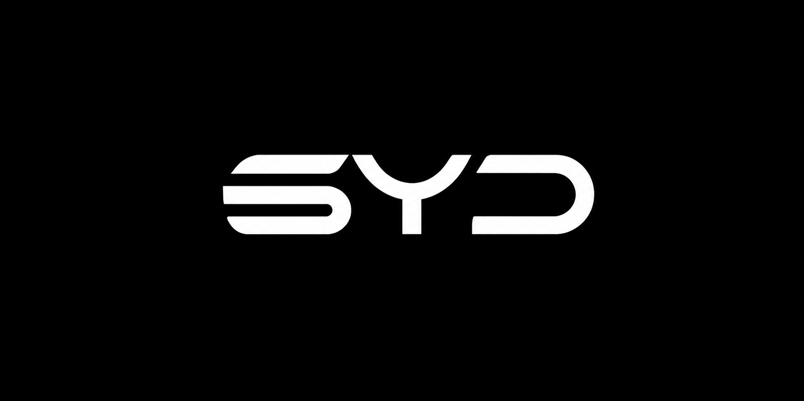

# LABSYD
Live above and beyond our space your dreams

  

LABSYD is a space-focused technology company exploring what becomes possible when software, satellites, and cybersecurity work together. We build and experiment at the intersection of space systems and digital technology, with a practical mindset and a curiosity for what comes next.
What we do
- Software — Developing thoughtful software and digital tools for complex, connected systems.
- Satellites & space technology — Exploring satellite-enabled capabilities and the technologies that help space systems operate.
- Cybersecurity — Focusing on security-minded engineering, resilient systems, and responsible cyber activities.
 
Our approach
We believe ambitious ideas deserve careful engineering. We value clear thinking, reliable technology, responsible security practices, and collaboration across disciplines. Our goal is to turn bold space dreams into useful, well-built technology.

Our vision
To help shape a future where space technology and secure software open new possibilities on Earth and beyond.

Connect
Interested in collaborating, building something, or learning more about LABSYD? Get in touch with our team.
LABSYD — Live above and beyond space dreams.
